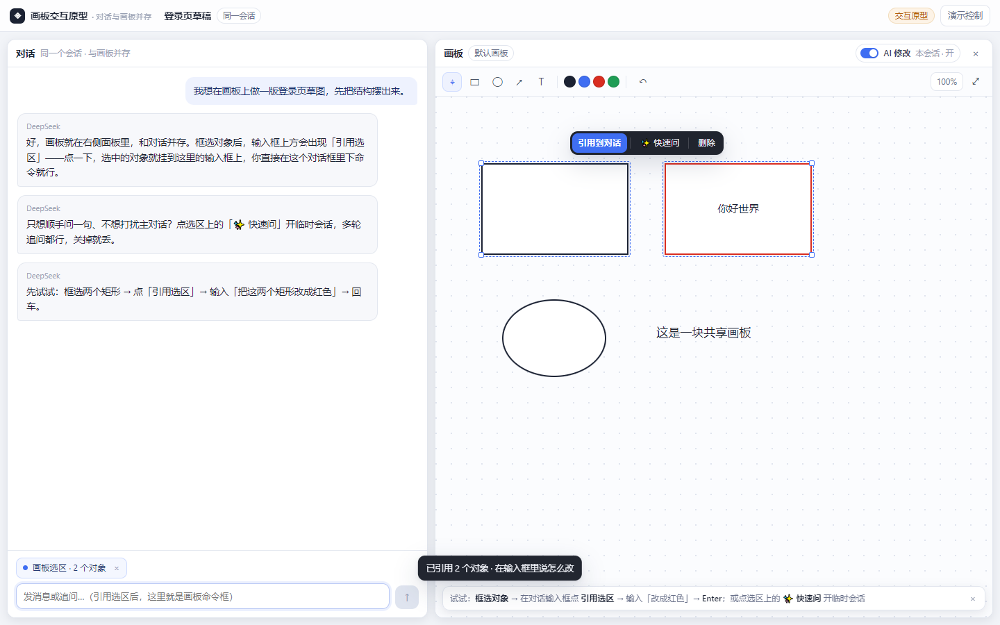

# 画板交互原型 v3（HTML，历史探索）

> **已被取代（2026-11-04）**：本原型是决策过程的一部分，**不是** v3 的实现依据。
> 其中的**临时会话浮窗、折叠卡片、可编辑引用文字块、对话内操作卡片**均已被否决；
> 最终设计见 [`../DECISIONS.md`](../DECISIONS.md) 与
> [`../adr/0003-canvas-agent-bridge.md`](../adr/0003-canvas-agent-bridge.md)。
> 仍然有效的部分：画板与对话并存的布局、引用 chip 的视觉、AI 开关、竞品参考表。
> 保留本文件仅作交互考古，不要按这里的临时会话/卡片实现。

单文件、可双击打开的交互原型，用来在动手改产品之前把**交互语法**确认下来。
文件：`canvas-panel.html`（无外部依赖，Chrome / Edge 直接打开即可）。



## 这一版要验证什么

上一版（v2）把画布 AI 做成了一个"贴选区的单次气泡"，被指出三个问题：像第二个聊天框、没有 AI 开关、没有"btw 临时会话"的语义。v3 按确认过的决策重做：

| 决策 | 落点 |
|---|---|
| Q1 AI 开关 | 画板头栏的「AI 修改」开关，**（画板 × 会话）粒度**，标签写「本会话 · 开/关」，默认开；关闭 = 完全禁用（不读不改），入口全部收起，已有修改保留可撤销 |
| Q2 引用 | **一次性**：选区变化时提示/引用自动跟随，发送即消费并清空；引用对象被删 → chip 标「已失效」 |
| Q3 临时会话 | 可同时开**最多 3 个浮窗**、每个**多轮**、结果直接落到画板；执行串行排队（DSH 一个会话同一时刻一轮） |
| Q4 默认动作 | 选中只把引用加到输入框；临时会话要手动点「✨ 快速问」 |
| Q5 升级/保存 | 关闭即弃（浮窗消失），但浮窗在对话里的折叠卡片保留，并提供「在对话中继续」——把选区重新引用回输入框，接着在主对话里说 |
| Q6 参考系 | 以 **Cursor / VS Code Copilot 的「选区→上下文→单输入框→Quick Chat」**为主参考，Figma/Miro 的画布行为为补充 |
| F1 引用怎么出现 | 选中 → 输入框上方出现**可点击的虚线提示**「引用选区（N 个对象）到对话」，点一下才转成正式引用 chip（不会静默挂载） |
| F2 开关粒度 | （画板 × 会话），画板头栏可见，默认开，关闭即完全禁用，明确写「本会话」 |
| F3 临时会话的痕迹 | 在对话里折叠成一张「临时会话」卡片：可展开 transcript、可撤销、可「在对话中继续」，不会平铺成普通消息 |
| F4 并发 | 最多 3 个浮窗，串行队列（后面的浮窗显示「排队中」，主对话的命令也进同一队列） |
| F5 关闭 AI | 完全禁用（引用、临时会话、AI 工具调用全部不可用），不是"只读" |

## 两条通道

### 主通道（durable）：选区 → 引用 → 复用对话框

1. 框选对象（点选 / Shift 多选 / 拖框）；
2. 下方对话输入框上方出现「✦ 引用选区（N 个对象）到对话」，点一下变成引用 chip；
3. **在同一个输入框里**输入命令（`Enter` 发送，`Shift+Enter` 换行；或选中后 `Ctrl/Cmd+Enter` 直接引用）；
4. 发送后：引用被消费、消息里带「◈ 画板选区 · N 个对象」小标记、对话里出现「画板操作」卡片（进行中）；
5. 画布上对象级状态：选区上方 chip「AI 正在处理 N 个对象 · 停止」，右下角可展开步骤面板；
6. 轮末就地应用，高亮 + toast（撤销）、卡片变「已应用 · 差异摘要」+ 撤销 / 再改一次 / 在画板中查看；`Ctrl/Cmd+Z` 也可撤销。

### 临时通道（ephemeral）：快速问

1. 选中对象 → 选区工具条点「✨ 快速问」；
2. 画布上浮出「临时会话」窗口（可拖动、可同时开 3 个），直接输入命令，多条追问都行；
3. 每轮结果直接应用，窗口里记录「已应用 · 差异摘要」，可撤销；
4. 对话里出现折叠的「临时会话 · N 个对象」卡片（展开看记录 / 在对话中继续 / 在画板中查看）；
5. 关闭浮窗（×）= 丢弃窗口，卡片留「浮窗已关闭」记录；点「在对话中继续」把该选区引用回输入框，转成主通道继续。

### AI 开关

画板头栏右侧：「AI 修改　本会话 · 开」。
关闭后：选区工具条只剩「删除」、输入框出现「AI 修改已关闭（本会话）· 在画板头栏重新打开」、临时会话全部关闭、队列清空、AI 请求被拒；已有修改不受影响、仍是可撤销的。

## 按剧本走一遍

| 步骤 | 操作 | 预期 |
|---|---|---|
| 1 | 框选两个矩形 | 选区工具条（引用到对话 / ✨ 快速问 / 删除）+ 输入框上方虚线提示 |
| 2 | 点输入框上方的「引用选区（2 个对象）到对话」 | 变成实心引用 chip「画板选区 · 2 个对象 ×」，输入框获得焦点 |
| 3 | 输入「把这两个矩形改成红色」→ `Enter` | 引用消失、消息带引用小标、卡片「进行中」、画布出现运行 chip |
| 4 | 等约 2.4 秒 | 两个矩形就地变红 + 高亮、toast「已应用 · 撤销」、卡片「已应用 · 描边改为红色 #d92d20」 |
| 5 | 点 toast 的「撤销」 | 画板恢复、卡片「已撤销」；`Ctrl/Cmd+Z` 等价 |
| 6 | 点画板头栏「AI 修改」关掉 | 工具条只剩删除、输入框显示关闭说明；再点开恢复 |
| 7 | 选中一个对象 →「✨ 快速问」 | 浮出临时会话窗口；输入「改成绿色」→ 回车，对象变绿；再输入「加粗一点」→ 继续生效 |
| 8 | 同时发起主对话命令 + 临时会话命令 | 第二个显示「排队中」，前一轮结束后自动执行 |
| 9 | 开第 4 个临时会话 | toast「最多同时开 3 个临时会话，先关掉一个」 |
| 10 | 关掉一个临时会话 | 浮窗消失；对话里对应卡片变「浮窗已关闭」 |
| 11 | 点卡片「在对话中继续」 | 该选区被引用回输入框，可直接在主对话里继续 |
| 12 | 关闭画板面板（标题栏 ×） | 对话恢复整宽 + 「打开画板」按钮；两者独立 |

键盘：`Esc` 关步骤面板/清选区；`Ctrl/Cmd+Z` 撤销；`Ctrl/Cmd+A` 全选；`Ctrl/Cmd+Enter` 引用选区；`Delete` 删除。

## 参考设计对照

| 参考 | 本原型的对应 |
|---|---|
| [VS Code Copilot Chat](https://code.visualstudio.com/docs/chat/chat-overview)：选区是隐式上下文、`#` 引用、单一聊天输入框 | 框选 → 引用 chip → 同一个对话输入框下命令；消息里带引用小标 |
| [VS Code inline chat / Quick Chat](https://code.visualstudio.com/docs/chat/inline-chat)：内联局部编辑 Keep/Undo；Quick Chat 是 **temporary conversation**，可 Open in Chat view | 「✨ 快速问」浮窗 = btw 临时会话；「在对话中继续」= Open in Chat 的轻量版 |
| [Cursor 快捷键/上下文](https://cursor.com/docs/reference/keyboard-shortcuts)：Add selection to Chat、`@` 挂上下文 | 选区引用（`Ctrl/Cmd+Enter`）、一次性消费、引用 chip |
| [ChatGPT 临时对话](https://help.openai.com/en/articles/8914046-temporary-chat-in-chatgpt)：不写入历史除非保存，离开后不可从历史重开 | 临时会话关闭即弃、只在对话里留折叠记录；不自动升级 |
| [Figma agent](https://help.figma.com/hc/en-us/articles/37998629035799-Work-with-the-Figma-agent-in-design-files)：画布上 prompt box、画布运行标记/步骤/Stop、可关闭 on-canvas prompting | 画布运行 chip/步骤/停止；AI 开关（比 Figma 更进一步放在头栏而不是 Preferences） |
| [Miro: Create with AI](https://help.miro.com/hc/en-us/articles/20164358139794-Create-with-AI)：选中画板内容作为 prompt 上下文；企业可禁用 AI | 选区作为引用上下文；AI 开关（本会话粒度） |
| [Google Docs Gemini](https://support.google.com/docs/answer/13447609?hl=en)：选区 → 浮动入口 → 就地建议 | 选区工具条 + 就地应用 + 撤销 |

## 自检脚本

`test/e2e/prototype-probe.mjs`（Playwright + 本机 Chrome，headless）：

```powershell
cd <path-to>\whiteboard-plugin-v2\test\e2e
node prototype-probe.mjs
```

覆盖：选区工具条 / 引用提示与 chip / 同一输入框发送 / 消息引用小标 / 运行态 chip / 应用与撤销 / AI 开关（工具条收起 + 关闭说明 + 恢复）/ 临时会话多轮 / 串行排队 / 3 个上限与第 4 个拒绝 / 关闭浮窗与卡片状态 / 「在对话中继续」/ 失败与重试 / 键盘 / 面板开合 / 1280×780 浮窗不越界。任一断言失败或出现 console error 时脚本非 0 退出；截图输出到 `docs/prototype/shots/probe/`。

## 已知边界

- AI 是**确定性模拟**（按关键词 红/蓝/绿/圆角/加粗/放大/文字 生成可预期修改），真实产品由模型经工具调用完成；
- 临时会话的"不写入主历史"是用**折叠卡片**模拟的，历史里仍有记录（选中方案 A：折叠 + 可追溯）；真正隔离的临时 session 是产品化阶段的可选工程项；
- 画板对象是静态示例，未实现缩放/平移/文本编辑/多画板/导入导出；
- 右侧面板用静态布局模拟，真实产品用 `sidebarRightTabs.register` + `sidebar.right.pane.tab` 接入，数据层/claim 机制不变。
